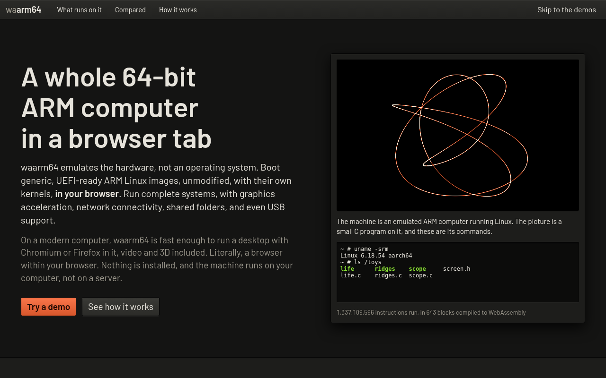

<p align="center"></p>

# waarm64

**A whole 64-bit ARM computer in a browser tab.**

waarm64 is a whole-system AArch64 (arm64) emulator that runs in the browser. It emulates the hardware, not an
operating system: unmodified Linux images boot through UEFI with their own kernels, as they would on a real machine or
in QEMU. Guest code is compiled to WebAssembly while it runs, which makes it fast enough for a desktop with a web
browser inside it, video and 3D included. Everything runs on your computer; nothing is emulated on a server.



**Try it: [waarm64.com](https://waarm64.com)** (Chrome, Edge or another Chromium-based browser). The page opens on an
introduction with a small machine booting live in it, then offers demos that start in a few seconds: Alpine at a
shell, and Arch Linux desktops with and without 3D.

## What it can do

- **A real machine, not a port.** Up to 8 cores, each on a thread of its own with real atomics, and up to 16 GiB of
  memory. The guest sees standard devices (virtio, xHCI, PL011, GICv3, UEFI firmware by EDK2), so there is no patched
  kernel and no driver to install. Debian, Arch and Alpine images boot as published.
- **3D graphics.** OpenGL ES 3.0 and OpenGL 2.1 through Mesa's virgl onto WebGL2, and Vulkan through Mesa's Venus
  onto WebGPU. The OpenGL path passes the 61,425 dEQP tests of our lists with none failing. sway, KDE Plasma, Firefox
  and Chromium with WebGL, vkQuake and Godot run.
- **Video and sound.** H.264, VP9 and AV1 are decoded by your browser's own decoder through VA-API in the guest, so
  YouTube plays inside the guest's browser. Sound plays through virtio-snd, and the microphone records.
- **Your devices and files.** USB devices passed through with WebUSB and WebHID, game controllers, a folder from your
  computer shared live into the guest, and a shared clipboard.
- **Disks and snapshots.** qcow2, raw and ISO images, opened from a file or a URL, up to 16 per machine. What the guest
  writes is kept in the browser and can be exported whole or as changes only. A running machine can be frozen, 3D
  programs and all, and continued later, or saved to a file and opened elsewhere.
- **Networking.** Up to 4 adapters per machine: your Tailscale network, a path online through your own computer,
  or peer-to-peer rooms between browsers.

## How it compares

Other projects run Linux in a browser, each with a different trade:
[unkernel](https://github.com/pithings/unkernel), [v86](https://github.com/copy/v86),
[WebVM](https://github.com/leaningtech/webvm) and [JSLinux](https://bellard.org/jslinux/). waarm64 is the one that
emulates a whole multi-core arm64 machine with GPU acceleration, and the others lead elsewhere: unkernel and v86 start
faster and run in more browsers, and unkernel needs far less memory. [docs/comparison.md](docs/comparison.md) has the
full table with sources.

On one CPU workload (the same Perl program run in each project's own Linux guest, measured 2026-11-20 in Chrome on an
Apple M4), waarm64 ran **1.8× as fast as unkernel** and **3.9× as fast as v86**. waarm64 and unkernel ran the very
same Debian binary; v86 emulates 32-bit x86, so its Perl is another build. The method and every run are in
[bench/compare/REPORT.md](bench/compare/REPORT.md).

## How it works

- **The processor.** An interpreter runs code that executes a few times; a block interpreter and then a JIT take
  over what runs often, compiling AArch64 blocks and regions to WebAssembly modules at run time. Compiled blocks chain
  into each other with tail calls, and memory accesses go through an inline software TLB.
  [docs/cpu.md](docs/cpu.md), [docs/jit.md](docs/jit.md), [docs/v8.md](docs/v8.md).
- **Memory.** A WebAssembly memory holds 4 GiB at most, so guest RAM past the first 3 GiB lives in further memories
  that Linux sees as NUMA nodes. [docs/architecture.md](docs/architecture.md),
  [docs/spill-memories.md](docs/spill-memories.md).
- **The platform and its devices.** The memory map, boot, interrupts, timers, virtio transports, block, network,
  input, 9p and USB. [docs/platform.md](docs/platform.md), [docs/devices.md](docs/devices.md),
  [docs/firmware.md](docs/firmware.md), [docs/usb.md](docs/usb.md).
- **Graphics and video.** The guest's Mesa sends virgl's command stream out; a renderer written for this project
  plays it on WebGL2, translating TGSI shaders to GLSL. Vulkan goes through Venus to a Mesa driver compiled to
  WebAssembly that targets WebGPU. Video frames are decoded by the browser. [docs/graphics.md](docs/graphics.md),
  [docs/audio.md](docs/audio.md).
- **The page.** A Svelte app that keeps machines, disks and snapshots in the browser, with a worker per vCPU and
  further workers for devices, the GPU and the network. [docs/frontend.md](docs/frontend.md),
  [docs/machines.md](docs/machines.md), [docs/shares.md](docs/shares.md), [docs/clipboard.md](docs/clipboard.md).
- **Networking.** [docs/networking/](docs/networking/adapters.md): the adapters, Tailscale and tailcat, the local
  helper, peer-to-peer rooms and their names.

The page's own introduction shows some of this live: real captured guest code beside the WebAssembly the JIT emitted
for it and the machine code the browser made of that, with notes on what each part is for.

## Run it locally

You need:

- **Node 26** or newer.
- **[rustup](https://rustup.rs)**, with a C compiler for Rust's build scripts (Xcode's command line tools on macOS,
  gcc or clang on Linux).
- **[Podman](https://podman.io/docs/installation)** (rootless), which builds the UEFI firmware and the other guest-side
  pieces in containers.

Then, in a clone:

```sh
npm start
```

It checks those, installs the npm packages, and builds what the page needs: the emulator core (Rust to WebAssembly,
with the nightly pinned in `rust-toolchain.toml`, which rustup installs the first time: ~700 MB; the build takes ~10 s
on an M4, longer on slower machines), the UEFI firmware (EDK2, ~1 min the first time), the guest agent for clipboard
sharing, the introduction's small machine, and Vulkan's renderer (a few minutes the first time). Then it builds the
page (Vite, ~1 s) and serves it on `http://127.0.0.1:8080/`.

Open that URL in **Chromium or Chrome**, which the project is built for. Firefox runs smaller guests, with worse
performance and stability, and without USB devices or shared folders. Then **[Open disk…](ui:machine:power-actions.openDisk)** (or drop a file on the page): an arm64
Linux disk image that boots through UEFI, as qcow2, raw or an ISO, such as a distribution's generic cloud image or its
installer. What the machine writes is kept in the browser's storage, per file, across reloads.

Run `npm start` again after pulling: it redoes only what changed, and with nothing to do it serves in about a second.

- `PORT=8081 npm start` picks another port. What the page keeps belongs to the address, so another port starts
  without it.
- **In a VM or on another machine:** the server listens on 127.0.0.1 only, and the page needs a secure context
  (localhost or HTTPS) for its shared memory. Forward the port and open the URL on your side:

  ```sh
  ssh -L 8080:127.0.0.1:8080 <the machine running npm start>
  ```

- `npm run dist` writes the page as static files to `target/dist/`, for any web server that can send the two
  cross-origin isolation headers ([docs/frontend.md](docs/frontend.md) "A static copy").

## Developing

> **A note from the author.** This project is presently set up for development by a single person, on a specific
> set of machines. [`CLAUDE.md`](CLAUDE.md) and the progress-tracking files in the repository's root (`PLAN.md`, the
> `*-KICKOFF.md` and `*-HANDOVER.md` files) reflect that specific setup. If you're interested in developing this for
> yourself with agentic help, you will need to adjust these files, and ideally one of your first contributions would
> be to modify them so that they're less specific. I'm not going to go through that trouble until a serious
> contributor shows up (you are always free to fork, and to maintain your fork as you please, of course). Let's just
> say I take the "without warranty" part of the MIT license very seriously, and that extends to (not) helping others
> collaborate on my projects.

```sh
npm run serve          # the dev server (Vite) with hot reloading, on :8080
scripts/ci-fast.sh     # after every change (~3 min): static checks and the tests the change touches
scripts/ci.sh          # before a push (~11 min): the full run; topic scripts (scripts/ci-*.sh) cover the rest
cargo test             # the core's native tests
images/build.sh        # guest images for the tests, in rootless Podman
```

- [`CLAUDE.md`](CLAUDE.md) has every command, the conventions and the working rules. It is written for the AI agents
  that work on the repository, and it is the most complete guide for a human too (with the author's own machines and
  hosts in it: the note above).
- [docs/devenv.md](docs/devenv.md) describes the development environment, [docs/testing.md](docs/testing.md) the
  test layers and CI tiers, [docs/benchmarking.md](docs/benchmarking.md) the benchmarks and their rules, and
  [docs/images.md](docs/images.md) the guest images.
- [docs/frontend-code.md](docs/frontend-code.md) and [docs/host-code.md](docs/host-code.md) are the rules of thumb for
  the page's code and the host's; [docs/i18n.md](docs/i18n.md) and [docs/copy.md](docs/copy.md) cover the page's
  words.
- [docs/decisions.md](docs/decisions.md) lists the decisions that bind the project, [`PLAN.md`](PLAN.md) the tracks
  of work, and [the GitHub issues](https://github.com/gbl08ma/waarm64/issues) the loose ends
  ([docs/issues.md](docs/issues.md)).
- [docs/README.md](docs/README.md) is the index of all of it.

## How it was made

waarm64 was created by one person in two months of spare time, with copious amounts of AI assistance: effectively all
of the code was written by Claude Opus 5.5, with a minority by Claude Fable 5.2, steered by a human, who also adjusted
some of the interface's design and words by hand. The
page's introduction has the author's own account of that, what it cost, and why. None of it would exist without the
open-source projects it builds on and learned from, which the About pane and
[`THIRD_PARTY.json`](THIRD_PARTY.json) credit.

## License

MIT ([`LICENSE`](LICENSE)). Third-party code, dependencies and their licenses are listed in
[`THIRD_PARTY.json`](THIRD_PARTY.json) ([docs/third-party.md](docs/third-party.md)). The introduction's small machine
ships Linux and BusyBox, which are GPL: their licenses and pinned source links are served beside the page.
